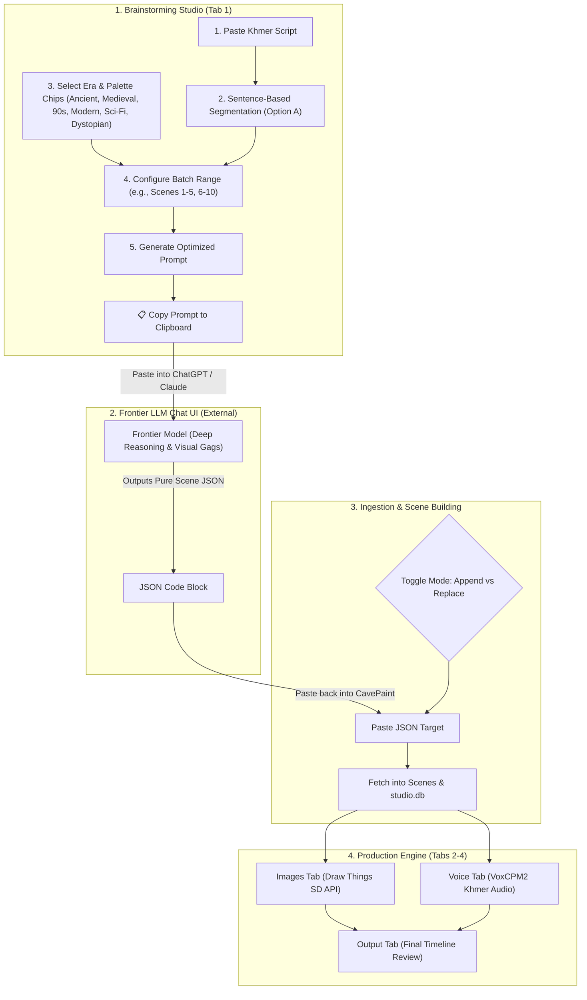

# CavePaint (Video Studio) — System Architecture & Technical Overview

> **Target Audience**: AI Agents and Engineers continuing development or maintenance on this codebase.  
> **Repository Root**: `.`  
> **Database File**: `./workspace/studio.db`  
> **Date Updated**: September 2026

---

## 1. Executive Summary & Mission

**CavePaint** is an automated, local-first content creation studio and production pipeline that transforms raw research notes and ideas into fully synthesized, scene-by-scene audio-visual timelines.

### Primary Purpose & Visual Identity
The system is built to automate the creation of educational/explainer videos in the visual style of YouTube channels like **Whatly**:
* **Visual Style**: Minimalist 2D flat vector stickman characters, bold clean outlines, plain solid color backgrounds, zero gradients or 3D shading.
* **Audio / Script**: Cinematic narrative scripts written and synthesized entirely in **Khmer** with native sentence pacing.
* **Pipeline Output**: Rendered high-resolution `.png` scene images paired with synchronized `.wav` or `.mp3` voiceover chunks and a concatenated `master_voiceover` timeline track, ready for Non-Linear Editors (NLEs) or FFmpeg rendering.

---

## 2. Brainstorming Pipeline: Human-in-the-Loop Frontier LLM Architecture

Instead of relying solely on generic background API calls, CavePaint utilizes a **Human-in-the-Loop Prompt & Batching Bridge** to harness the superior creative storytelling and visual reasoning of web-based frontier models (e.g. Claude 3.7 Sonnet / ChatGPT o3).



---

## 3. Technology Stack & Key Dependencies

### Frontend (`frontend/`)
* **Framework**: Next.js 16.2.7 (App Router, Turbopack enabled).
* **React Core**: React 19.2.4 & React-DOM 19.2.4.
* **Styling**: Tailwind CSS v4 (`@tailwindcss/postcss`).
* **Icons**: `lucide-react` (^1.17.0).
* **Language**: TypeScript 5.

### Backend (`backend/`)
* **Web Framework**: FastAPI 0.111.0, Uvicorn 0.30.1.
* **Database / ORM**: SQLite via SQLAlchemy >= 2.0.36.
* **Data Validation**: Pydantic >= 2.7.2.
* **LLM Clients**: `google-generativeai==0.8.4`, `groq>=0.9.0`.
* **Audio & Tensor Libraries**: `soundfile==0.12.1`, `numpy==1.26.4`, PyTorch (`torch.mps` / `torch.cuda`).
* **Local TTS Model**: `voxcpm` (`ravuthz/VoxCPM2-khmer`).
* **Environment Loader**: `python-dotenv==1.0.1` (loads `.env` and `.env.local`).

---

## 4. Database Schema & Data Models (`backend/database.py`)

The SQLite database is stored persistently at `workspace/studio.db`.

### 1. `Project` Table
Represents a complete video production workspace.
* `id` (`Integer`, PK): Unique project ID.
* `title` (`String`): Project display name.
* `slug` (`String`, Unique): Filesystem folder identifier (e.g., `why-are-we-alive`).
* `raw_research` (`Text`): Source raw notes, articles, or research prompts.
* `video_concept` (`Text`): High-level cinematic direction and theme.
* `script_narrative` (`Text`): Full flowing narrative script in Khmer.
* `illustration_style` (`Text`): Global visual prompt directive (stickman style).
* `global_voice_style` (`Text`): Acoustic styling and voiceover directives.
* `structured_json_data` (`Text`): JSON-stringified array of scene definitions.
* `status` (`String`): Current status (`draft`, `generating`, `completed`).
* `master_audio_path` (`String`): Relative path to combined audio (`workspace/<slug>/master_voiceover.wav`).
* `voice_profile_tag` (`String`): Global voice seed styling prompt tag.
* `audio_format` (`String`): Audio container format (`wav` or `mp3`, default `wav`).
* `theme_era` (`String`): Selected video era (e.g. `ancient`, `medieval`, `90s`, `modern`, `scifi`, `dystopian`).
* `theme_mood` (`String`): Selected backdrop palette (e.g. `pure_white`, `pale_ice`, `parchment_cream`, `muted_sand`, `slate_navy`, `dark_crimson`).
* `theme_custom` (`Text`): Specific environmental props and detail notes.
* `aspect_ratio` (`String`): Target video aspect ratio (`16:9`, `9:16`, `1:1`, `4:3`, `2:3`, default `16:9`).
* `character_attire` (`Text`): Era-appropriate clothing and hairstyle instructions (Whatly style).
* `scene_staging` (`String`): Staging mode (`studio` for grounded white backdrop or `environment` for full-bleed scenery).
* `scenes`: Relationship to `Scene` records with cascade delete.

### 2. `Scene` Table
Represents an individual slice/shot in the video timeline.
* `id` (`Integer`, PK): Unique scene ID.
* `project_id` (`Integer`, FK -> `projects.id`): Parent project link.
* `scene_number` (`Integer`): Sequential order in the timeline (1-based).
* `narration_khmer` (`Text`): Voiceover sentence in Khmer for this scene.
* `image_prompt_english` (`Text`): Positive Stable Diffusion prompt in English.
* `negative_prompt` (`Text`): Negative Stable Diffusion prompt constraints.
* `user_refinement_prompt` (`Text`): Natural language prompt edit history.
* `image_path` (`String`): Relative path to rendered image (e.g., `<slug>/scene_001.png`).
* `image_status` (`String`): `idle`, `processing`, `completed`, or `failed`.
* `audio_path` (`String`): Relative path to scene audio (e.g., `<slug>/scene_001.wav`).
* `audio_status` (`String`): `idle`, `processing`, `completed`, `failed`, or `outdated`.
* `character_id` (`Integer`, FK -> `characters.id`, Optional): Voice profile assigned.
* `character_name` (`String`, Optional): Cached display name of character.

### 3. `Character` Table
Global library of voice profiles across all projects.
* `id` (`Integer`, PK): Unique character ID.
* `name` (`String`): Display name.
* `gender` (`String`): `male` or `female`.
* `personality_tag` (`String`): Voice audition prompt (e.g., `[calm, deep, authoritative]`).
* `audio_path` (`String`): Path to reference `.wav` (`workspace/shared_characters/` or `custom_voices/`).
* `reference_text` (`String`): The exact transcription of the reference audio for zero-shot cloning.

### 4. `Setting` Table
Application-wide LLM configuration (single row).
* `active_provider` (`String`): `gemini` or `groq`.
* `active_slot` (`Integer`): Active API key slot (`1` or `2`).

---

## 5. Subsystems & Execution Logic

### 5.1 Single-Lane Sequential Worker (`backend/queue_worker.py`)
* Processes tasks strictly **one-at-a-time** (`asyncio.Queue`) to prevent VRAM exhaustion and GPU out-of-memory crashes between Draw Things and VoxCPM2.
* Task types: `image` (Draw Things render), `audio` (bulk voiceover generation), `audio_single` (targeted voice cloning).

### 5.2 Brainstorming Engine & Frontier Prompt Generator
The Brainstorming Studio integrates the following components:
1. **Script Segmentation**: Splits Khmer script by sentence termination tokens (`[។\n]+`).
2. **Theme & Setting Taxonomy**:
   * **Eras**: Ancient/Prehistoric, Medieval, 90s/Retro, Today/Modern, Future/Sci-Fi, Dystopian.
   * **Atmosphere/Backdrop Color**: Slate Navy, Warm Cream, Pale Ice Blue, Muted Sand, Dark Burgundy.
   * **Custom Flavor**: Specific props, attire, or environmental conditions.
3. **Chunking / Scene Batching**:
   * Generates prompts for discrete batches (e.g., Scenes 1–5, Scenes 6–10) with custom batch sizing to prevent model hallucination and preserve visual depth.
   * Injects strict JSON schema and anti-markdown instructions into the copied prompt.
4. **Scene Ingestion**:
   * Accepts pasted JSON arrays from the frontier chat UI.
   * Toggle between **Append** (adding new scenes sequentially) and **Replace All** (overwriting timeline).

### 5.3 Local Image Synthesis Engine (`backend/services/draw_things.py`)
* Connects to the local Draw Things REST API (`http://127.0.0.1:7860/sdapi/v1/txt2img`).
* Supports aspect ratio mapping (16:9, 9:16, 1:1, 4:3, 2:3), steps, and CFG scale.
* Includes a PIL fallback placeholder if the local service is offline.

### 5.4 Local Khmer Voice Engine (`backend/services/voice_engine.py`)
* Uses `ravuthz/VoxCPM2-khmer` with automatic 60-second idle VRAM unloading (`torch.mps.empty_cache()` / `torch.cuda.empty_cache()`).
* Injects sentence punctuation (`។`) and an acoustic silence cushion (0.20s).
* Concatenates individual chunks into `master_voiceover.<format>`.

---

## 6. Complete API Reference

| Method | Endpoint | Description |
|---|---|---|
| `GET` | `/api/health` | Backend health check. |
| `GET` | `/api/settings` | Retrieve active LLM provider and slot. |
| `PUT` | `/api/settings` | Update active LLM provider and slot. |
| `GET` | `/api/projects` | List all projects. |
| `GET` | `/api/projects/summary` | List projects with scene counts and completion stats. |
| `POST` | `/api/projects` | Create a new project. |
| `GET` | `/api/projects/{id}` | Get project details (with auto-healing filesystem validation). |
| `PUT` | `/api/projects/{id}` | Update project fields. |
| `DELETE` | `/api/projects/{id}` | Delete project and its workspace folder. |
| `POST` | `/api/projects/{id}/duplicate` | Duplicate project and copy scene definitions. |
| `POST` | `/api/projects/{id}/segment-script` | Programmatically split Khmer script by `។` and newlines into scenes. |
| `POST` | `/api/projects/{id}/import-scenes` | Ingest scenes from frontier LLM JSON (supports `append` or `replace`). |
| `POST` | `/api/projects/{id}/reset-voice` | Clear all generated audio files and reset voice seed for project. |
| `PUT` | `/api/scenes/{id}` | Update scene prompts, narration, or notes. |
| `POST` | `/api/scenes/{id}/refine` | AI-rewrite image positive & negative prompts with user instructions. |
| `POST` | `/api/scenes/{id}/generate-image` | Enqueue an image generation task. |
| `POST` | `/api/scenes/{id}/stop` | Interrupt active image generation. |
| `DELETE` | `/api/scenes/{id}/image` | Delete scene image file and reset scene status. |
| `POST` | `/api/scenes/{id}/generate-audio` | Enqueue single scene audio generation task. |
| `POST` | `/api/projects/{id}/generate-voice` | Enqueue audio generation for all scenes. |
| `POST` | `/api/projects/{id}/stop-voice` | Cancel all pending voice tasks for the project. |
| `GET` | `/api/characters` | List all saved voice cloning character profiles. |
| `POST` | `/api/characters` | Create a new character (supports upload or audition sample promotion). |
| `DELETE` | `/api/characters/{id}` | Delete a character profile and its audio file. |
| `POST` | `/api/characters/preview` | Generate an audition audio sample from personality tags. |
| `DELETE` | `/api/characters/preview` | Delete temporary audition sample. |
| `POST` | `/api/characters/preview-clone` | Test clone voice from an uploaded sample before saving. |
| `DELETE` | `/api/characters/preview-clone` | Delete temporary clone test audio. |
| `POST` | `/api/model/load` | Manually load VoxCPM2 into memory. |
| `POST` | `/api/model/unload` | Manually unload VoxCPM2 and free VRAM. |
| `GET` | `/api/model/status` | Check memory state of VoxCPM2. |
| `GET` | `/static/*` | Static file server mounting `workspace/` assets. |

---

## 7. Frontend Architecture & Studio Tabs

### 7.1 Context Hierarchy (`frontend/app/context/`)
* **`UIContext`**: Global UI preferences (theme, active tab, sidebar state).
* **`ProjectsListContext`**: Project directory list, creation, deletion, duplication.
* **`ProjectDataContext`**: Active project state, scene data, updates, and synchronization.
* **`ProjectContext`**: Unified facade hook combining all contexts.

### 7.2 Studio Production Tabs
1. **Brainstorming Tab (`OverviewTab.tsx` / Brainstorming)**:
   * **Left Panel (Script & Theme Studio)**:
     * Khmer narrative script input textarea with live sentence counter.
     * Selectable Era chips (Ancient, Medieval, 90s, Modern, Sci-Fi, Dystopian).
     * Selectable Solid Background Tone chips (Deep Slate, Warm Cream, Pale Ice, Muted Sand, Crimson).
     * Custom environment flavor / prop notes.
     * Batch Range Controller (Scene batch size + Batch 1, Batch 2, etc. selector).
     * **"📋 Copy Frontier Prompt" Button**: Generates and copies the ready-to-use prompt for ChatGPT/Claude.
   * **Right Panel (Scene Ingestion & Storyboard Deck)**:
     * JSON Paste Target with syntax validator.
     * **Import Mode Toggle**: `[ Append ]` vs `[ Replace All ]`.
     * **"📥 Ingest into Timeline" Button**.
     * Live Storyboard Scene Cards showing Scene #, Khmer Line, and English Stickman Prompt with direct editing capabilities.
2. **Images Tab (`ImagesTab.tsx`)**:
   * Scene navigation deck with green render badges.
   * English positive and negative prompt editors.
   * AI natural language prompt refinement assistant.
   * Aspect ratio controls and live render canvas with Lightbox.
3. **Voice Tab (`VoiceTab.tsx`)**:
   * Character profile library and Voice Factory (Audition generator & Clone uploader).
   * Timeline audio speaker mapping and batch voice generation.
4. **Output Tab (`OutputTab.tsx`)**:
   * Vertical production timeline matching rendered `.png` image frames with the synthesized `.wav`/`.mp3` audio tracks.

---

## 8. Directory & File Organization

```
video_studio/
├── AGENTS.md                   # Agent guidelines & Next.js warning
├── CLAUDE.md                   # Legacy engine specification notes
├── overview.md                 # THIS FILE (Comprehensive system documentation)
├── .env.local                  # Local API keys (Gemini & Groq)
│
├── backend/
│   ├── main.py                 # FastAPI application, REST routers & lifecycle
│   ├── database.py             # SQLAlchemy models, SQLite connection & migrations
│   ├── queue_worker.py         # Asyncio sequential background worker
│   ├── requirements.txt        # Python pip dependencies
│   └── services/
│       ├── draw_things.py      # Draw Things REST API integration
│       ├── voice_engine.py     # VoxCPM2 TTS, cloning, and VRAM manager
│       ├── llm_orchestrator.py # High-level field generation router
│       └── llm/
│           ├── client.py       # Multi-provider client (Gemini & Groq)
│           └── orchestrators/  # Dedicated prompt engineering logic
│               ├── concept.py
│               ├── illustration.py
│               ├── refinement.py
│               ├── script.py
│               ├── structure.py
│               └── vocal.py
│
├── frontend/
│   ├── package.json            # Next.js 16 dependencies
│   ├── app/
│   │   ├── layout.tsx          # Root layout with UI & ProjectsList providers
│   │   ├── page.tsx            # Welcome screen / redirect
│   │   ├── globals.css         # Global styling & custom scrollbars
│   │   ├── context/            # Split context architecture
│   │   │   ├── ProjectContext.tsx
│   │   │   ├── ProjectDataContext.tsx
│   │   │   ├── ProjectsListContext.tsx
│   │   │   ├── UIContext.tsx
│   │   │   └── types.ts
│   │   ├── components/
│   │   │   ├── shell/          # Sidebar, ProjectHeader, WelcomeScreen
│   │   │   └── tabs/           # OverviewTab (Brainstorming), ImagesTab, VoiceTab, OutputTab
│   │   └── projects/[id]/      # Dynamic project routing
│   │       ├── layout.tsx      # Project data provider & layout wrapper
│   │       ├── overview/page.tsx
│   │       ├── images/page.tsx
│   │       ├── voice/page.tsx
│   │       └── output/page.tsx
│
└── workspace/                  # Physical disk asset storage (ignored by git)
    ├── studio.db               # SQLite database file
    ├── shared_characters/      # AI-generated character voice profiles
    ├── custom_voices/          # Uploaded reference voice WAVs
    └── <project-slug>/         # Project-specific rendered images & audio chunks
```

---

## 9. Environment Setup & Execution Guide

### Prerequisites
1. **Python Environment**: Conda environment named `voice` (Python 3.10+):
   ```bash
   conda activate voice
   ```
2. **Node.js**: Node 18+ or 20+.
3. **Draw Things**: Draw Things application installed on macOS with the HTTP REST API enabled in Settings (`Port 7860`).
4. **Environment Variables**: Create `.env.local` or `.env` in the project root:
   ```env
   GEMINI_KEY_1=your_gemini_api_key_here
   GEMINI_KEY_2=your_optional_backup_gemini_key
   GROQ_KEY_1=your_groq_api_key_here
   GROQ_KEY_2=your_optional_backup_groq_key
   ```

### Starting the Application
* **Start Backend**:
  ```bash
  conda activate voice
  uvicorn backend.main:app --reload --port 8000
  ```
* **Start Frontend**:
  ```bash
  cd frontend
  npm run dev
  ```
* Open your browser to `http://localhost:3000`.

---

## 10. Developer Gotchas & Critical Guidelines

1. **Next.js 16 Dynamic Route Parameters**:
   In Next.js 16 App Router, `params` in layout components is a `Promise`. It **must** be unwrapped using React's `use(params)` before accessing properties (e.g. `const { id } = use(params);`).
2. **GPU Concurrency Lockout**:
   Never bypass the `task_queue` in `queue_worker.py` to run model generation concurrently in threads. Concurrent execution of Draw Things and VoxCPM2 on macOS Unified Memory causes heavy paging or kernel panic.
3. **Khmer Script Termination**:
   Khmer sentences must terminate with the special character `។`. The voice engine checks and enforces this before inference to ensure correct cadence and intonation.
4. **SQLite JSON Synchronization**:
   Whenever a scene's prompt, narration, or order is updated via `/api/scenes/{id}`, the helper function `sync_project_json` is invoked to synchronize the changes back into the parent project's `structured_json_data` column.
5. **Asset URL Resolution**:
   Assets stored under `workspace/<slug>/` are referenced in the database as relative paths (e.g. `my-project/scene_001.png`). The frontend converts these to URLs using `http://localhost:8000/static/<filename>`.
